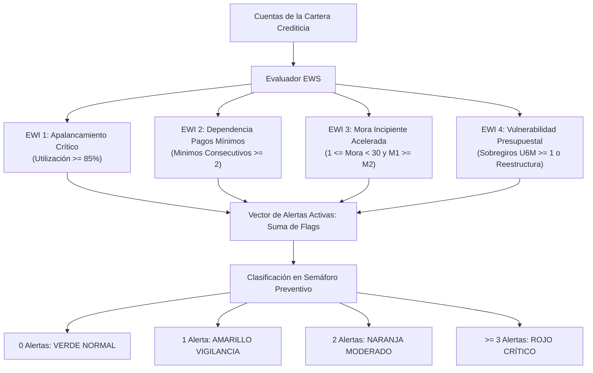

# Reporte de Avance Metodológico y Nuevas Implementaciones — Reporte Semanal 2
## Proyecto de Residencia Profesional — Fase 2 (Alertas Tempranas y Detección Proactiva de Estrés Financiero)

---

**Institución Académica:** Tecnológico de Estudios Superiores de Ecatepec (TESE)  
**División Académica:** División de Informática  
**Carrera:** Ingeniería / Licenciatura en Informática  
**Proyecto:** Prototipo de Motor de Decisiones Comportamentales para Riesgo de Crédito (Arquitectura Basada en PowerCurve Strategy Management)  
**Autor / Residente:** Marco Antonio Oroza Ortega  
**Fecha de Reporte:** Octubre 2026  
**Tipo de Entrega:** Reporte de Avance Metodológico Semanal 2 (Metodología e Implementación)  
**Despliegue Productivo:** [https://motor-decisiones-marco.streamlit.app](https://motor-decisiones-marco.streamlit.app)  

---

## 1. Introducción y Contexto de la Evolución Semanal

En cumplimiento estricto del cronograma de trabajo formalizado en el **Reporte de Avance Metodológico Semanal 1**, el presente documento detalla la investigación, diseño metodológico, codificación e integración correspondientes al ciclo semanal 2 de la Residencia Profesional.

Durante la primera etapa se sentaron las bases fundacionales de la plataforma:
1. Arquitectura limpia en capas desacopladas (Clean Architecture y Domain-Driven Design).
2. Contratos de calidad de datos y validación de esquemas con Pydantic.
3. Pipeline de ingeniería de variables comportamentales (*roll-rates*, ratios de uso).
4. Árbol de prelación jerárquica con 4 políticas maestras (*Knock-out*, *Contención*, *Mitigación*, *Expansión* y *Mantenimiento*).
5. Framework de experimentación estratégica **Champion vs. Challenger** y Matriz Bidimensional de Cupos por Deciles de Score.

No obstante, en la gestión crediticia contemporánea, esperar a que un cliente incurra en morosidad severa ($\ge 60$ o $90$ días) para ejecutar una acción de contención representa una pérdida patrimonial irreversible para la institución. Los estándares internacionales (**Basilea III** y la Norma Internacional de Información Financiera **IFRS 9**) exigen la adopción de modelos **proactivos y prospectivos** (*forward-looking*) capaces de clasificar el riesgo en etapas y detectar indicios sutiles de fatiga financiera.

Por consiguiente, este avance semanal incorpora el **Sistema de Alertas Tempranas (Early Warning System - EWS)**, un subsistema analítico de inteligencia preventiva que monitorea patrones comportamentales atípicos para interceptar el deterioro crediticio en su fase germinal.

---

## 2. Marco Metodológico: Sistema de Alertas Tempranas (EWS)

### 2.1 Fundamento Regulatorio y Financiero (IFRS 9 y Basilea III)

Bajo la normativa IFRS 9, los instrumentos de crédito se clasifican en tres etapas de riesgo:
- **Stage 1 (Riesgo Normal):** Créditos sin deterioro significativo; se reservan pérdidas crediticias esperadas (ECL) a 12 meses.
- **Stage 2 (Incremento Significativo del Riesgo de Crédito - SICR):** Créditos que exhiben señales tempranas de estrés sin encontrarse en default; la regulación obliga a provisionar reservas por toda la vida remanente del crédito (*Lifetime ECL*).
- **Stage 3 (Default / Deterioro Objetivo):** Créditos con mora $\ge 90$ días o evidencia de quiebra.

El objetivo metodológico del EWS es constituirse como el **mecanismo de clasificación anticipada para Stage 2**. Mediante el cómputo de indicadores heurísticos de estrés, el motor identifica a los clientes que requieren intervenciones operativas preventivas antes de comprometer el índice de morosidad (IMOR) de la cartera.

```
                           ESQUEMA DE CLASIFICACIÓN IFRS 9 Y EWS
┌─────────────────────────────────┬─────────────────────────────────┬─────────────────────────────────┐
│     STAGE 1 (Normalidad)        │    STAGE 2 (Estrés Incipiente)  │       STAGE 3 (Default)         │
├─────────────────────────────────┼─────────────────────────────────┼─────────────────────────────────┤
│ • Sin morosidad significativa   │ • Incremento de utilización     │ • Atraso severo >= 90 días      │
│ • Score Prime / Regular         │ • Dependencia de pagos mínimos  │ • Reestructuras en mora         │
│ • Monitoreo pasivo ordinario    │ • Mora incipiente (1-29 días)   │ • Pérdida esperada materializada│
│ ➔ EWS: Nivel VERDE (Normal)    │ ➔ EWS: Nivel AMARILLO / NARANJA │ ➔ EWS: Nivel ROJO (Crítico)     │
└─────────────────────────────────┴─────────────────────────────────┴─────────────────────────────────┘
```

---

### 2.2 Taxonomía de los 4 Indicadores de Alerta Temprana (Early Warning Indicators - EWIs)

El modelo matemático del EWS evalúa simultáneamente cuatro dimensiones ortogonales del comportamiento financiero del acreditado:



#### Indicador 1: Apalancamiento Crítico (`FLAG_EWI_USO`)
- **Fórmula de Activación:**  
  $$\text{FLAG\_EWI\_USO} = \mathbb{I}\left( \frac{\text{SALDO\_ACTUAL}}{\text{LIMITE\_CREDITO\_ACTUAL}} \times 100 \ge 85.0\% \right)$$
- **Racional Financiero:** Un ratio de utilización superior al 85% es el predictor empírico más robusto de saturación de capacidad de pago. Representa a clientes con escaso o nulo margen de maniobra ante eventualidades de liquidez.

#### Indicador 2: Dependencia y Fatiga de Pagos Mínimos (`FLAG_EWI_MINIMOS`)
- **Fórmula de Activación:**  
  $$\text{FLAG\_EWI\_MINIMOS} = \mathbb{I}\left( \text{PAGOS\_MINIMOS\_CONSECUTIVOS} \ge 2 \right)$$
- **Racional Financiero:** Cubrir únicamente la fracción del pago mínimo de manera recurrente amortiza exclusivamente cargos financieros e intereses ordinarios, sin reducir el principal. Denota pérdida de solvencia y estrés de liquidez recurrente.

#### Indicador 3: Mora Incipiente Acelerada (`FLAG_EWI_MORA_INCIPIENTE`)
- **Fórmula de Activación:**  
  $$\text{FLAG\_EWI\_MORA\_INCIPIENTE} = \mathbb{I}\left( 0 < \text{DIAS\_ATRASO\_M1} < 30 \quad \land \quad \text{DIAS\_ATRASO\_M1} \ge \text{DIAS\_ATRASO\_M2} \right)$$
- **Racional Financiero:** Detecta el vector de *roll-forward* en su etapa inicial. Si el cliente experimenta un atraso de entre 1 y 29 días y éste es igual o mayor al atraso del mes previo, el cliente está desarrollando una trayectoria hacia cubetas de mora más severas (Bucket 1 $\rightarrow$ Bucket 2).

#### Indicador 4: Vulnerabilidad Presupuestal Histórica (`FLAG_EWI_VULNERABILIDAD`)
- **Fórmula de Activación:**  
  $$\text{FLAG\_EWI\_VULNERABILIDAD} = \mathbb{I}\left( \text{NUM\_SOBREGIROS\_U6M} \ge 1 \quad \lor \quad \text{FLAG\_REESTRUCTURA\_PREVIA} = 1 \right)$$
- **Racional Financiero:** Refleja fragilidad estructural. Un cliente que ha superado su límite contractual o que ha precisado un convenio de reestructuración previa posee una probabilidad acumulada de impago sensiblemente superior a la media de la población.

---

### 2.3 Matriz de Gradación de Riesgo y Acciones Preventivas Vinculadas

El acumulado de indicadores activos determina el **Nivel de Riesgo Preventivo EWS** y dicta la prescripción de una acción correctiva estandarizada:

| Nivel de Riesgo EWS | Indicadores Activos | Semáforo | Acción Preventiva Estandarizada | Impacto en Operación |
| :--- | :---: | :---: | :--- | :--- |
| **VERDE_NORMAL** | 0 alertas | 🟢 Verde | `MONITOREO_ESTANDAR_SIN_RESTRICCION` | Operación ordinaria; elegible para campañas de fidelización y ofertas de expansión. |
| **AMARILLO_VIGILANCIA** | 1 alerta | 🟡 Amarillo | `CONGELAR_OFERTAS_Y_RECORDATORIO_PREVENTIVO` | Se suprimen ofertas comerciales cruzadas y se programan notificaciones preventivas previas a la fecha límite de pago. |
| **NARANJA_MODERADO** | 2 alertas | 🟠 Naranja | `REDUCIR_LINEA_Y_RESTRINGIR_SOBREGIROS` | Mitigación activa de la exposición crediticia (*EAD*); restricción absoluta de autorizaciones por sobregiro. |
| **ROJO_CRITICO** | $\ge 3$ alertas | 🔴 Rojo | `BLOQUEO_PREVENTIVO_Y_CONTACTO_RETENCION` | Congelamiento temporal de línea y derivación prioritaria a la célula especializada de retención y cobranza preventiva. |

---

## 3. Detalle de las Nuevas Implementaciones Técnicas

### 3.1 Módulo Especializado: `src/engine/early_warning.py`
Se implementó un módulo desacoplado y reutilizable que alberga:
- **`EWI_CATALOG`**: Diccionario formal con la metadata, códigos estandarizados y definiciones de cada uno de los 4 indicadores.
- **Clase `EarlyWarningSystem`**:
  - `evaluate_portfolio(df_features)`: Ejecuta vectorizadamente en Pandas/NumPy las 4 condiciones lógicas, calcula `NUM_ALERTAS_EWI` (entero de 0 a 4), asigna el semáforo `NIVEL_RIESGO_EWI` y prescribe la `ACCION_PREVENTIVA_EWI`.
  - `generate_ews_summary(df_evaluated)`: Compila estadísticas agregadas de la cartera (totales por semáforo, conteo de gatillos detonados y porcentaje neto de población en riesgo activo).

### 3.2 Exportación Limpia en la Arquitectura: `src/engine/__init__.py`
Se integró el nuevo componente en la interfaz pública del paquete de motor de decisiones:
```python
from src.engine.early_warning import EarlyWarningSystem, EWI_CATALOG

__all__ = [
    # ... componentes previos
    "EarlyWarningSystem",
    "EWI_CATALOG",
]
```

### 3.3 Nueva Pestaña Especializada en la Plataforma Web: `src/app/dashboard.py` (Tab 3)
La plataforma interactiva se enriqueció con una pestaña dedicada: **"🚨 Alertas Tempranas (EWS)"**, dotada de:
1. **4 Tarjetas KPI Fintech:** Indicadores de semáforo (Verde, Amarillo, Naranja, Rojo) con conteo absoluto y participación porcentual.
2. **Gráfica de Dona Interactiva (Plotly):** Distribución visual del semáforo preventivo con código cromático normativo.
3. **Histograma Horizontal de Frecuencia de EWIs:** Permite visualizar de un vistazo cuál es el principal factor de estrés de la cartera (e.g. fatiga de pagos mínimos vs. saturación de línea).
4. **Matriz de Anticipación Cruzada:** Tabla cruzada bidimensional entre `NIVEL_RIESGO_EWI` y `DECISION_FINAL`, demostrando cuántos contratos calificados en mantenimiento ordinario presentan ya focos amarillos o naranjas de alerta.
5. **Padrón Filtrable de Cuentas en Riesgo:** Vista tabular interactiva para auditar cuentas específicas con sus gatillos activos y acción recomendada.

### 3.4 Enriquecimiento del Expediente de Cuenta 360° (Tab 4)
En la vista individual de cliente se incorporó:
- **Badge Cromático EWS:** Indicador visual directo en el encabezado del expediente junto a la decisión de política.
- **Panel de Diagnóstico EWS:** Detalle de la acción preventiva recomendada y 4 pastillas visuales (*chips*) que señalan en rojo o verde el estado de cada uno de los cuatro indicadores para la cuenta seleccionada.

### 3.5 Controles Dinámicos en Barra Lateral y Pestaña de Cartera (Tab 5)
- Se añadió un panel expansible en la barra lateral para ajustar dinámicamente los umbrales de sensibilidad del EWS (porcentaje de uso crítico y número de pagos mínimos de alerta).
- Se agregó el campo `NIVEL_RIESGO_EWI`, `NUM_ALERTAS_EWI` y `ACCION_PREVENTIVA_EWI` en el visor tabular de cartera y en los archivos descargables (CSV y JSON de auditoría).

### 3.6 Ampliación de la Suite de Pruebas Automatizadas: `tests/test_rules_engine.py`
Se desarrollaron 3 pruebas unitarias exhaustivas adicionales en Pytest, elevando la batería de pruebas a **15 pruebas unitarias automatizadas (100% exitosas)**:
- `test_ews_individual_indicators()`: Valida individualmente que cada uno de los 4 indicadores responda estrictamente a su condición lógica financiera.
- `test_ews_risk_tiers_classification()`: Comprueba la correcta clasificación de los cuatro niveles del semáforo (Verde, Amarillo, Naranja, Rojo) y sus acciones preventivas asignadas.
- `test_ews_summary_generation()`: Verifica la exactitud de los conteos y porcentajes del resumen ejecutivo de auditoría.

---

## 4. Resultados Experimentales en la Cartera Base (2,500 Cuentas)

Al procesar la cartera institucional precargada de 2,500 cuentas bajo el nuevo módulo de Alertas Tempranas, se obtuvieron los siguientes resultados estadísticos exactos:

### 4.1 Distribución del Semáforo Preventivo EWS

| Nivel de Riesgo Preventivo | Número de Cuentas | Participación Porcentual | Acción Preventiva Dictaminada |
| :--- | :---: | :---: | :--- |
| **VERDE_NORMAL** | 916 | 36.64% | `MONITOREO_ESTANDAR_SIN_RESTRICCION` |
| **AMARILLO_VIGILANCIA** | 554 | 22.16% | `CONGELAR_OFERTAS_Y_RECORDATORIO_PREVENTIVO` |
| **NARANJA_MODERADO** | 458 | 18.32% | `REDUCIR_LINEA_Y_RESTRINGIR_SOBREGIROS` |
| **ROJO_CRITICO** | 572 | 22.88% | `BLOQUEO_PREVENTIVO_Y_CONTACTO_RETENCION` |
| **TOTAL** | **2,500** | **100.00%** | **Población Total Auditada** |

> **Métrica Clave:** El **41.20%** de la cartera (1,030 cuentas) se ubica en **Riesgo Activo** ($\ge 2$ alertas activas, niveles Naranja y Rojo), requiriendo intervención operativa inmediata de mitigación o contención.

---

### 4.2 Detonaciones por Indicador de Alerta Temprana (EWIs)

| Código de Indicador | Nombre del Indicador | Cuentas que lo Detonan | Frecuencia Relativa |
| :--- | :--- | :---: | :---: |
| **EWI 1 (`FLAG_EWI_USO`)** | Saturación de Línea ($\ge 85\%$) | 475 cuentas | 19.00% |
| **EWI 2 (`FLAG_EWI_MINIMOS`)** | Dependencia Pagos Mínimos ($\ge 2$) | 1,057 cuentas | 42.28% |
| **EWI 3 (`FLAG_EWI_MORA_INCIPIENTE`)** | Mora Incipiente Creciente (1 a 29 días) | 774 cuentas | 30.96% |
| **EWI 4 (`FLAG_EWI_VULNERABILIDAD`)** | Sobregiros U6M o Reestructura Previa | 991 cuentas | 39.64% |

**Hallazgo Analítico:** La **dependencia de pagos mínimos** (42.28%) y la **vulnerabilidad por sobregiros o reestructuras previas** (39.64%) son las señales tempranas con mayor incidencia en la población, confirmando que la pérdida de liquidez precede por semanas a la manifestación del impago contractual prolongado.

---

### 4.3 Matriz de Anticipación: Semáforo EWS vs. Decisión de Política Tradicional

La siguiente tabla cruzada revela la ventaja competitiva y metodológica de implementar el EWS frente al árbol jerárquico reactivo:

| Nivel de Riesgo EWS | MANTENER CONDICIONES | REDUCIR LÍNEA PREVENTIVA | BLOQUEO TEMPORAL | CANCELAR Y COBRANZA | INCREMENTAR LÍNEA | TOTAL |
| :--- | :---: | :---: | :---: | :---: | :---: | :---: |
| **VERDE_NORMAL** | 290 | 1 | 0 | 0 | **625** | 916 |
| **AMARILLO_VIGILANCIA** | **511** | 43 | 0 | 0 | 0 | 554 |
| **NARANJA_MODERADO** | **271** | 130 | 57 | 0 | 0 | 458 |
| **ROJO_CRITICO** | **60** | 225 | 162 | 125 | 0 | 572 |
| **TOTAL** | **1,132** | **399** | **219** | **125** | **625** | **2,500** |

#### Conclusiones Metodológicas Extraídas de la Matriz:
1. **Consistencia de Expansión:** Las 625 cuentas aprobadas para incremento de cupo (`INCREMENTAR_LINEA_PROACTIVO`) pertenecen **al 100% al nivel Verde**, lo que demuestra que el motor jamás otorga aumentos de cupo a clientes que presenten alertas tempranas activas.
2. **Capacidad de Anticipación Temprana:** Existen **271 cuentas en riesgo Naranja** y **60 cuentas en riesgo Rojo** que el motor de políticas reactivo mantenía en `MANTENER_CONDICIONES_ACTUALES` por no haber alcanzado aún los 30 o 90 días de mora. Gracias al EWS, la institución puede congelar ofertas comerciales e intervenir preventivamente a estas **331 cuentas vulnerables** antes de que generen quebrantos crediticios.

---

## 5. Cronograma Actualizado de Próximos Avances Semanales

```
                                  CRONOGRAMA DE ENTREGABLES
   [SEMANA 1 - HECHO]             [SEMANA 2 - HECHO]             [PRÓXIMA SEMANA 3]             [SEMANA 4 - CIERRE]
  ┌───────────────────────┐      ┌───────────────────────┐      ┌───────────────────────┐      ┌───────────────────────┐
  │ Champion / Challenger │ ───> │ Sistema de Alertas    │ ───> │ Reporting Regulatorio │ ───> │ Stress Testing Masivo │
  │ & Matriz de Cupos     │      │ Tempranas (EWS / EWI) │      │ Automatizado (PDF/XLS)│      │ & Memoria Técnica     │
  └───────────────────────┘      └───────────────────────┘      └───────────────────────┘      └───────────────────────┘
```

1. **Semana 1 (Completada):**
   - Formalización del marco metodológico de ingeniería y riesgo.
   - Implementación del módulo Champion/Challenger y Matriz Bidimensional de Límites.
   - Batería inicial de pruebas en Pytest (12/12 exitosas).
2. **Semana 2 (Completada — Reporte Presente):**
   - Diseño del modelo matemático de Alertas Tempranas (EWS) alineado a IFRS 9 Stage 2.
   - Desarrollo del módulo `src/engine/early_warning.py` con 4 indicadores y catálogo EWI.
   - Integración de la Pestaña 3 en Streamlit y panel de diagnóstico individual en Expediente 360°.
   - Ampliación de la batería de pruebas en Pytest a **15 pruebas unitarias (100% exitosas)**.
3. **Próxima Semana (Semana 3):**
   - **Módulo de Reporting Regulatorio y Auditoría Automatizada:** Implementación de un generador de reportes formales en formato PDF institucional y hojas de cálculo Excel (`.xlsx`) estructuradas con tablas dinámicas, descargables con un solo clic desde la interfaz web.
4. **Semana 4 (Cierre de Etapa):**
   - **Pruebas de Estrés Masivo (*Stress Testing*):** Evaluación de rendimiento computacional procesando lotes de 50,000 a 100,000 contratos sintéticos en memoria, midiendo tiempos de respuesta, latencia y consumo de recursos para la memoria técnica final.

---

**Firma del Residente:**  
**Marco Antonio Oroza Ortega**  
División de Informática  
Tecnológico de Estudios Superiores de Ecatepec (TESE)
