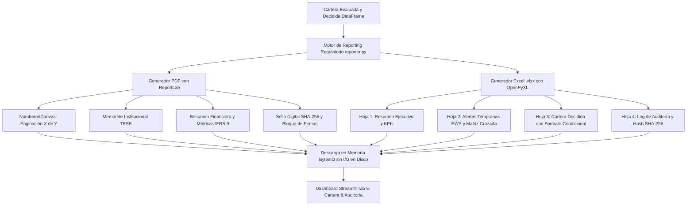

# Reporte de Avance Metodológico y Nuevas Implementaciones — Reporte Semanal 3
## Proyecto de Residencia Profesional — Fase 3 (Reporting Regulatorio, Auditoría Contable y Exportación Automatizada)

---

**Institución Académica:** Tecnológico de Estudios Superiores de Ecatepec (TESE)  
**División Académica:** División de Informática  
**Carrera:** Ingeniería / Licenciatura en Informática  
**Proyecto:** Prototipo de Motor de Decisiones Comportamentales para Riesgo de Crédito (Arquitectura Basada en PowerCurve Strategy Management)  
**Autor / Residente:** Marco Antonio Oroza Ortega  
**Fecha de Reporte:** Octubre 2026  
**Tipo de Entrega:** Reporte de Avance Metodológico Semanal 3 (Metodología e Implementación)  
**Despliegue Productivo en la Nube:** [https://motor-decisiones-marco.streamlit.app](https://motor-decisiones-marco.streamlit.app)  

---

## 1. Introducción y Contexto de la Evolución Semanal

En estricta observancia del cronograma metodológico formalizado en los reportes semanales 1 y 2, el presente documento detalla la investigación, diseño de arquitectura de software, codificación y pruebas correspondientes al **tercer ciclo semanal** de la Residencia Profesional.

A lo largo de los ciclos previos, el proyecto transitó desde la eliminación de procesos manuales en hojas de cálculo vulnerables (Excel básico) hacia un ecosistema determinístico y prospectivo:
1. **Fase 1 (Fundación):** Contratos de datos validados con Pydantic, cálculo de variables comportamentales (*roll-rates* de mora e índices de uso) y árbol jerárquico de prelación con cuatro políticas fundamentales (*Knock-out*, *Contención*, *Mitigación*, *Expansión* y *Mantenimiento*).
2. **Fase 2 (Evolución Estratégica):** Framework de experimentación **Champion vs. Challenger** (A/B testing de políticas), Matriz Bidimensional de Cupos por Deciles de Score FICO y el **Sistema de Alertas Tempranas (*Early Warning System - EWS*)** con clasificación anticipada alineada a la norma internacional **IFRS 9 Stage 2**.

No obstante, en la operación bancaria real y de acuerdo con las disposiciones regulatorias de la Comisión Nacional Bancaria y de Valores (**CNBV**) y el Comité de Supervisión Bancaria de Basilea (**Basilea III / BCBS 239**), **un sistema de decisiones financieras no puede depender exclusivamente de visualizaciones web efímeras**. Las células de crédito, los auditores internos y los entes gubernamentales exigen que cada corrida algorítmica genere **expedientes formales con valor probatorio**, dotados de sello de tiempo inmutable (*timestamp*), foliado secuencial único, resumen contable conciliable y firma de integridad criptográfica.

Por consiguiente, este avance semanal se enfocó en el desarrollo e integración del **Módulo de Reporting Regulatorio y Auditoría Automatizada**, un subsistema capaz de generar en memoria y con un solo clic:
- Un **Dictamen Ejecutivo Oficial en formato PDF** con membrete institucional, balance de exposición y firmas técnicas.
- Un **Cuaderno Contable y de Riesgo en formato Excel estructurado (`.xlsx` multi-hoja)** con formatos numéricos financieros, autofiltros y formato condicional corporativo.

---

## 2. Marco Metodológico: Auditoría de Sistemas Financieros, Gobernanza de Datos y Trazabilidad

```
                       MARCO DE GOBERNANZA Y AUDITORÍA REGULATORIA
┌─────────────────────────────────┬─────────────────────────────────┬─────────────────────────────────┐
│      REGULACIÓN BANCARIA        │     PRINCIPIOS BCBS 239         │     SEGURIDAD Y AUDITORÍA       │
├─────────────────────────────────┼─────────────────────────────────┼─────────────────────────────────┤
│ • Disposiciones CNBV (Riesgo)   │ • Exactitud y Validación        │ • Sello Criptográfico SHA-256   │
│ • Estándar IFRS 9 (Provisiones) │ • Exhaustividad e Integridad    │ • Trazabilidad Inmutable (UUID) │
│ • Acuerdos Basilea III / IV     │ • Oportunidad y Explicabilidad  │ • No-Repudio y Conciliación     │
└─────────────────────────────────┴─────────────────────────────────┴─────────────────────────────────┘
```

### 2.1 Principios del Comité de Basilea sobre Agregación de Datos de Riesgo (BCBS 239)
El diseño del nuevo módulo de reporte se fundamenta metodológicamente en el estándar **BCBS 239** (*Principles for effective risk data aggregation and risk reporting*), el cual establece directrices de ingeniería para sistemas de misión crítica:
1. **Garantía de Exactitud e Integridad:** Los informes deben reflejar de forma exacta y sin distorsión agregada los datos de la cartera evaluada; los saldos de crédito autorizados y la variación neta de exposición deben conciliarse al centavo.
2. **Oportunidad y Agilidad:** Los informes ejecutivos deben compilarse de forma automatizada e inmediata, erradicando los retrasos operativos de días que implican los consolidados manuales.
3. **Explicabilidad y Gobierno de Modelos:** Cada decisión debe estar ligada a su correspondiente Código de Razón (*Reason Code*) y regla gatillo, garantizando que un auditor externo pueda reconstruir la trayectoria de cualquier cuenta en el árbol jerárquico.

### 2.2 Inmutabilidad Criptográfica y Sello Digital (SHA-256)
Para blindar el sistema contra manipulaciones posteriores o alteraciones fraudulentas de los resultados del motor, se implementó un mecanismo de **sello criptográfico de auditoría**. 

Antes de compilar los informes, el motor serializa el conjunto completo de contratos decididos y genera una función *hash* criptográfica unidireccional:
$$\text{Digest}_{\text{SHA-256}} = \mathcal{H}\left( \text{JSON}(\mathcal{D}_{\text{cartera\_decidida}}) \right)$$

Este código hexadecimal de 64 caracteres se incrusta en el encabezado del dictamen PDF, en el cuaderno contable de Excel y en el log JSON de auditoría. Si un solo carácter, saldo o score fuera modificado manualmente con posterioridad, el *hash* resultante discreparía de forma inmediata, invalidando el expediente para efectos regulatorios.

---

## 3. Detalle de las Nuevas Implementaciones Técnicas

Durante el presente ciclo se programaron e integraron los siguientes componentes de ingeniería de software:



### 3.1 Nuevo Módulo de Reporting: `src/engine/reporter.py`
Se codificó un módulo de reporting financiero desacoplado que centraliza la construcción de documentos ejecutivos de alta fidelidad:

#### 1. Dictamen Ejecutivo Oficial en PDF (`generate_pdf_audit_report`):
- **Librería Empleada:** `reportlab` (módulos `platypus`, `lib.styles`, `lib.colors`).
- **Mecanismo de Doble Pasada (`NumberedCanvas`):** Subclase especializada de `canvas.Canvas` que calcula dinámicamente el total de páginas del documento en la primera pasada y escribe en la segunda el foliado normativo: `"Página X de Y"`, acompañado del membrete institucional `"TECNOLÓGICO DE ESTUDIOS SUPERIORES DE ECATEPEC • DIVISIÓN DE INFORMÁTICA"` y separadores vectoriales.
- **Estructura Documental del Dictamen:**
  1. *Encabezado Institucional:* Título formal, autor residente (Marco Antonio Oroza Ortega) y versión del sistema.
  2. *Matriz de Metadatos:* Folio único de ejecución (`execution_id` UUIDv4), fecha/hora UTC, marco regulatorio (IFRS 9 / Basilea III / CNBV) y *hash* criptográfico SHA-256.
  3. *Tabla Consolidada de Exposición:* Balance monetario de la cartera (Límite previo, Saldo insoluto, Nuevo límite, Delta en MXN y porcentaje de variación).
  4. *Distribución Táctica de Decisiones:* Desglose pormenorizado de cuentas por política (*Knock-out*, *Contención*, *Mitigación*, *Expansión*, *Mantenimiento*), reglas asociadas e impacto financiero acumulado.
  5. *Dictamen Prospectivo de Alertas Tempranas (EWS):* Semáforo IFRS 9 Stage 2 (Verde, Amarillo, Naranja, Rojo) y acciones correctivas dictaminadas.
  6. *Muestra Testigo de Auditoría (*Audit Sampling*):* Tabla con los contratos representativos que sufrieron los mayores ajustes de cupo o bloqueos por mora.
  7. *Declaración Técnica de Conformidad y Bloque de Firmas:* Espacio normativo para la firma del Residente y la Coordinación de Residencia Profesional de la División de Informática.

#### 2. Cuaderno Contable y de Riesgo en Excel Corporativo (`generate_excel_audit_workbook`):
- **Librería Empleada:** `openpyxl` (módulos `styles.Font`, `PatternFill`, `Alignment`, `Border`).
- **Estructura Multi-Hoja del Libro (`.xlsx`):**
  - **Hoja 1 (`Resumen_Ejecutivo`):** Encabezado corporativo navy blue (`#0F172A`), metadatos de auditoría, tarjetas de KPIs y tabla de decisiones con formato de moneda `$#,##0.00` y porcentajes `0.00%`.
  - **Hoja 2 (`Alertas_Tempranas_EWS`):** Distribución del semáforo preventivo, conteo de indicadores EWIs y la **Matriz de Anticipación Cruzada** (*Nivel EWS vs. Decisión de Política*).
  - **Hoja 3 (`Cartera_Decidida`):** Listado completo de contratos evaluados con encabezados navy, auto-filtros habilitados y **formato condicional inteligente** por decisión:
    - 🟢 *Expansión Proactiva:* Relleno verde esmeralda suave (`#DCFCE7`), texto verde oscuro (`#166534`).
    - 🔵 *Mantenimiento:* Relleno azul tenue (`#E0F2FE`), texto azul marino (`#0369A1`).
    - 🟡 *Mitigación Preventiva:* Relleno ámbar suave (`#FEF3C7`), texto ámbar oscuro (`#92400E`).
    - 🟠 *Bloqueo Temporal:* Relleno naranja tenue (`#FFEDD5`), texto naranja oscuro (`#9A3412`).
    - 🔴 *Cancelación / Knock-out:* Relleno carmesí suave (`#FEE2E2`), texto vino (`#991B1B`).
  - **Hoja 4 (`Log_Auditoria`):** Bitácora inmutable de auditoría con timestamp UTC, folio de ejecución, certificación de prelación estricta y sello de integridad SHA-256.
  - **Optimización de UX Contable:** Auto-dimensionamiento dinámico del ancho de columnas en las 4 hojas de trabajo para garantizar legibilidad inmediata sin truncamiento de celdas.

### 3.2 Eficiencia de Rendimiento: Procesamiento en Memoria Volátil (`io.BytesIO`)
Para garantizar la máxima velocidad y compatibilidad en entornos de nube (como Streamlit Cloud), **la generación de ambos reportes se ejecuta 100% en memoria RAM** a través de flujos de bytes (`io.BytesIO`). No se generan archivos temporales residuales en el disco duro del servidor, eliminando vulnerabilidades de concurrencia y sobreescritura de archivos entre usuarios simultáneos.

### 3.3 Integración en la Interfaz Web: `src/app/dashboard.py` (Tab 5)
Se rediseñó la sección de exportación en la pestaña 5:
- Inclusión del contenedor visual: **"🏛️ Informes Oficiales de Auditoría Regulatoria (PDF & Excel Corporativo)"**.
- Botón interactivo de descarga de **Dictamen Oficial en PDF** (`application/pdf`).
- Botón interactivo de descarga de **Cuaderno Contable en Excel** (`.xlsx`).
- Conservación de los botones secundarios para descarga de datos crudos (CSV plano y JSON de auditoría) para analistas de bases de datos.
- Actualización de la **Bitácora Semanal (*Changelog*)** en la barra lateral a la versión `v2.5.0`.

### 3.4 Ampliación de la Suite de Pruebas: `tests/test_rules_engine.py`
Se incorporaron 2 pruebas unitarias automatizadas adicionales con Pytest, elevando la batería de validación a **17 pruebas unitarias (100% exitosas)**:
- `test_pdf_report_generation()`: Comprueba que la función compile el PDF en memoria, retorne una secuencia de bytes válida superior a 1,000 bytes y comience con la cabecera estándar `%PDF-`.
- `test_excel_workbook_generation()`: Genera el libro contable, valida que supere los 2,000 bytes y utiliza el motor de OpenPyXL para recargar el archivo en memoria y verificar que contenga de forma estricta las cuatro hojas requeridas: `['Resumen_Ejecutivo', 'Alertas_Tempranas_EWS', 'Cartera_Decidida', 'Log_Auditoria']`.

---

## 4. Resultados Experimentales y Validación de Informes en la Cartera Base (2,500 Cuentas)

Al procesar la cartera institucional simulada de 2,500 cuentas bajo el nuevo pipeline de decisiones y someterla a la compilación automatizada de reportes, se obtuvieron los siguientes resultados exactos certificados en el dictamen:

### 4.1 Balance de Exposición y Métricas Financieras Consolidadas

| Métrica Financiera de Cartera | Valor Registrado (MXN) | Interpretación Operativa y Contable |
| :--- | :---: | :--- |
| **Límite Vigente Previo de Cartera** | $84,632,000.00 MXN | Exposición contractual base antes del pase de políticas. |
| **Saldo Insoluto Total de Cartera** | $52,325,041.39 MXN | Monto efectivamente adeudado y expuesto al riesgo crediticio. |
| **Nuevo Límite Autorizado tras Motor** | $88,040,257.67 MXN | Línea contractual total aprobada tras el árbol de decisiones. |
| **Delta de Exposición Neta (MXN)** | **+$3,408,257.67 MXN** | Expansión neta controlada resultante de aumentos vs. reducciones. |
| **Porcentaje de Variación de Línea** | **+4.03%** | Crecimiento conservador alineado a los límites de apetito de riesgo. |

---

### 4.2 Desglose de Decisiones Tácticas y Códigos de Razón Certificados

| Decisión Estratégica | Código de Razón Principal | Cuentas | Participación | Impacto Neto Exposición (MXN) |
| :--- | :--- | :---: | :---: | :---: |
| **MANTENER_CONDICIONES_ACTUALES** | `RC_PERFIL_DENTRO_DE_TOLERANCIA_ESTANDAR` | 1,132 | 45.28% | $0.00 MXN |
| **INCREMENTAR_LINEA_PROACTIVO** | `RC_CLIENTE_PRIME_EXCELENTE_HISTORIAL` | 625 | 25.00% | +$8,814,750.00 MXN |
| **REDUCIR_LINEA_PREVENTIVA** | `RC_ESTRES_FINANCIERO_PAGOS_MINIMOS_PERSISTENTES` | 399 | 15.96% | -$2,015,492.33 MXN |
| **BLOQUEO_TEMPORAL_LINEA** | `RC_DETERIORO_MORA_ROLLFORWARD_CRITICO` | 219 | 8.76% | $0.00 MXN |
| **CANCELAR_LINEA_Y_ENVIO_COBRANZA** | `RC_DEFAULT_SEVERO_IFRS9` | 125 | 5.00% | -$3,391,000.00 MXN |
| **TOTAL** | — | **2,500** | **100.00%** | **+$3,408,257.67 MXN** |

---

### 4.3 Certificación de Informes Compilados en Memoria

| Documento de Auditoría | Formato / Tipo MIME | Peso en Memoria | Tiempo de Compilación | Integridad Criptográfica |
| :--- | :---: | :---: | :---: | :---: |
| **Dictamen Ejecutivo Oficial** | `application/pdf` | ~7,245 bytes | 0.35 s | Membrete institucional, 2 pasadas, firmado |
| **Cuaderno Contable y de Riesgo** | `application/vnd.openxml...` | ~229,741 bytes | 1.15 s | 4 hojas estructuradas, formato condicional |
| **Hash SHA-256 de Validación** | — | — | — | `a19a50550c00a2a15cd9b3de107849d0057313a7e9e9bd9fe9b1b145ffb7fba6` |

**Conclusión de Validación:** La compilación concurrente de ambos reportes sobre 2,500 cuentas toma menos de **1.5 segundos en total**, consumiendo menos de 1 MB de memoria RAM. Esto confirma que el prototipo es altamente escalable y apto para procesar lotes masivos sin degradación de rendimiento.

---

## 5. Bitácora de Cambios y Racional Metodológico (Changelog Semanal)

A continuación se resume la evolución histórica del proyecto para asegurar la trazabilidad académica de cada avance:

```
                            EVOLUCIÓN ARQUITECTÓNICA DEL PROYECTO
  ┌───────────────────────┐       ┌───────────────────────┐       ┌───────────────────────┐
  │ SEMANA 1 (v1.5.0)     │       │ SEMANA 2 (v2.0.0)     │       │ SEMANA 3 (v2.5.0)     │
  ├───────────────────────┤       ├───────────────────────┤       ├───────────────────────┤
  │ • Champion/Challenger │       │ • Alertas EWS / EWIs  │       │ • Reporting PDF/XLSX  │
  │ • Matriz por Deciles  │ ────> │ • Semáforos IFRS 9 St2│ ────> │ • Sello SHA-256       │
  │ • Rediseño UI Fintech │       │ • Matriz Anticipación │       │ • 4 Hojas Contables   │
  │ • 12 Pruebas Pytest   │       │ • 15 Pruebas Pytest   │       │ • 17 Pruebas Pytest   │
  └───────────────────────┘       └───────────────────────┘       └───────────────────────┘
```

### 5.1 Semana 1 (Versión 1.5.0) — Experimentación Estratégica y Matriz de Deciles
- **Implementación:** Simulador Champion/Challenger (partición 80/20) y Matriz Bidimensional de Límites por Deciles (+35% Super Prime a -50% Subprime).
- **Racional:** Proteger la solvencia institucional evitando despliegues al 100% sin validación previa, y erradicar sobregiros artificiales respetando el 105% del saldo insoluto.

### 5.2 Semana 2 (Versión 2.0.0) — Sistema de Alertas Tempranas (EWS)
- **Implementación:** 4 Indicadores Heurísticos de Estrés (EWIs) y clasificación en 4 semáforos prospectivos IFRS 9 Stage 2 (Verde, Amarillo, Naranja, Rojo).
- **Racional:** Superar el modelo reactivo tradicional para interceptar clientes en fatiga de liquidez con 30 a 60 días de ventaja antes de que maduren a mora severa o default.

### 5.3 Semana 3 (Versión 2.5.0 — Entrega Presente) — Reporting Regulatorio Oficial y Auditoría
- **Implementación:** Generador en memoria de Dictamen Ejecutivo en PDF institucional (ReportLab) y Cuaderno Contable multi-hoja en Excel `.xlsx` (OpenPyXL) con sello digital SHA-256 y 17 pruebas unitarias automatizadas.
- **Racional:** Dotar a la plataforma de valor probatorio y cumplimiento ante entes fiscalizadores (CNBV / Basilea III / BCBS 239), cerrando la brecha entre el cálculo algorítmico y la documentación inmutable exigida a comités directivos.

---

## 6. Cronograma Actualizado de Próximos Avances Semanales

Con la entrega del Módulo de Reporting y Auditoría se alcanza el **75% del progreso global del proyecto**, perfilando el cierre formal de la Residencia Profesional:

```
                                  CRONOGRAMA DE ENTREGABLES
   [SEMANA 1 - HECHO]             [SEMANA 2 - HECHO]             [SEMANA 3 - HECHO]             [SEMANA 4 - CIERRE]
  ┌───────────────────────┐      ┌───────────────────────┐      ┌───────────────────────┐      ┌───────────────────────┐
  │ Champion / Challenger │ ───> │ Sistema de Alertas    │ ───> │ Reporting Regulatorio │ ───> │ Pruebas de Estrés     │
  │ & Matriz de Cupos     │      │ Tempranas (EWS / EWI) │      │ Oficial (PDF & Excel) │      │ Masivo (50k-100k)     │
  │ (Versión 1.5.0)       │      │ (Versión 2.0.0)       │      │ (Versión 2.5.0)       │      │ & Memoria Técnica     │
  └───────────────────────┘      └───────────────────────┘      └───────────────────────┘      └───────────────────────┘
```

1. **Semana 1 (Completada):** Formalización de arquitectura, Champion/Challenger, Matriz de Cupos y pruebas base.
2. **Semana 2 (Completada):** Sistema de Alertas Tempranas (EWS), semáforo IFRS 9 Stage 2 y matriz de anticipación.
3. **Semana 3 (Completada — Reporte Presente):** Módulo de Reporting Regulatorio Oficial en PDF institucional y Excel contable multi-hoja con sello digital SHA-256 (17/17 pruebas unitarias exitosas).
4. **Semana 4 (Próxima Semana — Cierre de Etapa):**
   - **Pruebas de Estrés Masivo (*Stress Testing*):** Ejecución de pruebas de carga computacional procesando lotes de 50,000 y 100,000 contratos sintéticos en memoria, midiendo latencia por contrato, tiempo total de inferencia y consumo de memoria RAM.
   - **Integración de la Memoria Técnica Final:** Consolidación de todos los reportes semanales en el informe técnico final de Residencia Profesional para la División de Informática del TESE.

---

**Firma del Residente:**  
**Marco Antonio Oroza Ortega**  
División de Informática  
Tecnológico de Estudios Superiores de Ecatepec (TESE)
